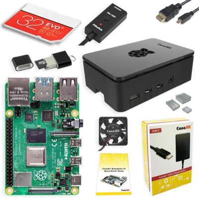

# 🔋 pidog-energy

<p align="center">🇺🇸 <b>English</b> · 🇫🇷 <a href="README.fr.md">Français</a></p>

**Battery monitoring for the SunFounder PiDog robot dog.**
When power runs low, the dog tells you — out loud.

> *« Énergie faible. 30 pour cent. »* ("Low power. 30 percent." — the dog speaks French by default, see `voix_langue`.)

A dependency-free background service that runs **alongside your other
PiDog programs** — notably [pidog-voice](https://github.com/koua29/pidog-voice).

---

## What it does

- Reads the battery voltage and converts it to a percentage
- At each threshold crossed: **barks**, then **announces the level out loud**
- **Each threshold alerts only once** — no nagging at 29%, 28%, 27%…
- **Stays quiet while charging**
- Re-arms itself once the battery is recharged
- Survives reboots: the thresholds already announced are stored on disk

## Three design choices that matter

**It doesn't move a single servo.** The alert is sound-only. A robot sitting on a
table can be monitored with no risk of it falling off.

**It never instantiates `Pidog()`.** The voltage is read directly from the
robot-hat's ADC. That is what lets this service run *alongside*
pidog-voice: two `Pidog` objects in two processes would fight over the GPIO.

**It doesn't blindly trust the ADC.** Two separate problems, both observed:
the converter is noisy by ±0.08 V, and — trickier — it returns **flat 0.00 V**
readings when the servos draw current (2 readings out of 9 during a walk). So the service
discards any reading below 5 V *before* taking the median: a 2S pack below 5 V
could no longer power the Pi, which would be off.

Without that filter, the median lands on 0 and the robot announces "battery critical, 10
percent" while it's at 7.4 V. It happened, hence the fix.

---

## Installation

```bash
git clone https://github.com/koua29/pidog-energy.git
cd pidog-energy
./install/pi_service.sh          # cron @reboot + supervision, no sudo needed
```

Check:

```bash
python3 energy.py --etat         # voltage, percentage, thresholds already announced
tail -f ~/pidog-energy.log
```

Uninstall: `./install/pi_service.sh --retirer`

## Manual use

```bash
python3 energy.py                # service (infinite loop)
python3 energy.py --etat         # current state
python3 energy.py --test 30      # plays the 30% alert right away
python3 energy.py --verifier     # validates config.json
python3 energy.py --oublier      # re-arms every threshold
```

---

## Configuration

Everything lives in **`config.json`**. No code to change.

```json
"alertes": [
  { "pourcent": 30, "aboiements": 3 },
  { "pourcent": 20, "aboiements": 4 },
  { "pourcent": 10, "aboiements": 5,
    "annonce": "Batterie critique. {pourcent} pour cent. Rechargez-moi." }
],
"annonce_par_defaut": "Energie faible. {pourcent} pour cent.",
"rearmement_pourcent": 50
```

| Setting | Role |
|---|---|
| `alertes[].pourcent` | Trigger threshold (percent) |
| `alertes[].aboiements` | Number of barks before the sentence (`0` = voice only) |
| `alertes[].annonce` | Sentence specific to this threshold; `{pourcent}` is substituted |
| `annonce_par_defaut` | Sentence used when the threshold doesn't define one (`null` = barks only) |
| `rearmement_pourcent` | Above this level, every threshold can be announced again |
| `batterie.intervalle_s` | Time between two measurements (60 s by default) |
| `batterie.lectures_par_mesure` | Number of readings the median is taken from |
| `voix_langue` | Language of the `pico2wave` speech synthesis (`fr-FR`; e.g. `en-US` for English) |

Adding a threshold only takes one more block in `alertes`. Then validate
with `python3 energy.py --verifier`: it rejects duplicates, out-of-range
thresholds, and a `rearmement_pourcent` set below the highest threshold.

### A fast drop triggers the right alert

If the battery goes from 35% to 8% between two measurements, the service announces **10%**,
not 30%: it always keeps the lowest threshold reached.

---

## Limitations, honestly

**The percentage is approximate.** It comes from a **linear** conversion of the
voltage (8.4 V = 100%, 6.4 V = 0%). But a lithium cell holds a plateau around
7.4 V then drops sharply: the real "50%" comes later than the
calculation says. The bounds are in `config.json`, adjust them to your pack.

**Charge detection is an inference, not a measurement.** The robot-hat
exposes no charging signal. The service concludes it's charging when it sees a
sustained voltage rise, or an end-of-charge voltage (≥ 8.25 V). Two
consequences: the very first minutes after plugging in may go unnoticed,
and a freshly unplugged pack is still considered charging for a while.

---

## 🤝 Project hardware

*Amazon affiliate links: if you buy through these links, the project earns a small commission at no extra cost to you.*

<table>
<tr>
<td align="center" width="33%">
  <a href="https://www.amazon.com/dp/B07V5JTMV9?linkCode=ll2&amp;tag=koua29penergy-20&amp;ref_=as_li_ss_tl"></a><br>
  <b><a href="https://www.amazon.com/dp/B07V5JTMV9?linkCode=ll2&amp;tag=koua29penergy-20&amp;ref_=as_li_ss_tl">CanaKit Raspberry Pi 4 (4 GB)</a></b><br><sub>Kit with the board that runs inside the dog</sub>
</td>
<td align="center" width="33%">
  <a href="https://www.amazon.com/dp/B0B7NVMBPL?linkCode=ll2&amp;tag=koua29penergy-20&amp;ref_=as_li_ss_tl"></a><br>
  <b><a href="https://www.amazon.com/dp/B0B7NVMBPL?linkCode=ll2&amp;tag=koua29penergy-20&amp;ref_=as_li_ss_tl">SanDisk 64 GB microSD (2-pack)</a></b><br><sub>Raspberry Pi OS and the project files</sub>
</td>
<td align="center" width="33%">
  <a href="https://www.amazon.com/dp/B0FLD69KFF?linkCode=ll2&amp;tag=koua29penergy-20&amp;ref_=as_li_ss_tl"></a><br>
  <b><a href="https://www.amazon.com/dp/B0FLD69KFF?linkCode=ll2&amp;tag=koua29penergy-20&amp;ref_=as_li_ss_tl">Anker Soundcore 2 (Bluetooth speaker)</a></b><br><sub>The music the dog listens to, and its replies</sub>
</td>
</tr>
</table>

<sub>As an Amazon Associate I earn from qualifying purchases.</sub>

## ☕ Buy me a coffee

This project is free and open source. If you find it useful, you can say thanks
by buying me a coffee — just scan this PayPal QR code. Thanks a lot! 🙏

<p align="center">
  
</p>

## See also

- **[pidog-voice](https://github.com/koua29/pidog-voice)** — French voice control
  for the same robot. Both services run together without conflict.

## License

[MIT](LICENSE) © 2026 koua29
